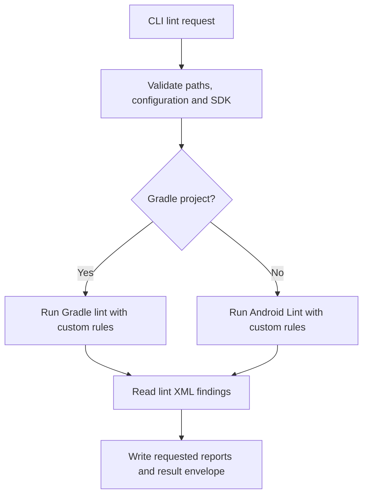
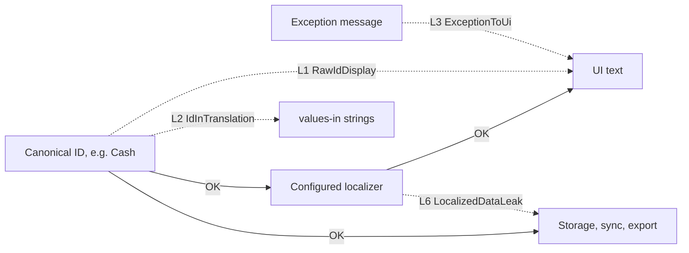

# Indonesian-English localization lint

Android Lint checks for localization at resource, display and data boundaries. Indonesian is the default target locale; the configured locale list is not restricted to English and Indonesian. The checks use Android Lint's issue IDs and suppression mechanisms. See [IMPLEMENTATION_PLAN.md](IMPLEMENTATION_PLAN.md) for intended scope and limitations.

## Build and prerequisites

Install JDK 21 and set `JAVA_HOME`. Install the Android SDK and set `ANDROID_HOME` or `ANDROID_SDK_ROOT` to its directory; integration fixtures use Android SDK Platform 36. The build pins Gradle 9.7.1, Kotlin 2.4.21, and Android Lint 32.5.0; the Android Gradle Plugin belongs to the consuming app. On macOS/Linux, make the wrapper executable with `chmod +x gradlew` and run `./gradlew build`; on Windows run `gradlew.bat build` in Command Prompt or `./gradlew.bat build` in PowerShell. Quote paths containing spaces. No compatibility combination is yet claimed as verified: CI targets AGP 9.0 and 9.5, using AGP's built-in Kotlin support, and exercises the shared fixture separately on AGP 9.5.

## Gradle integration

Build and publish locally with `./gradlew publishToMavenLocal` (use `gradlew.bat` on Windows). In the consuming project's plugin management and dependency repositories include `mavenLocal()`, `google()` and `mavenCentral()`. Apply `id("dev.androidkit.i18n-lint") version "0.1.0-SNAPSHOT"` to an Android application, library, test or dynamic-feature module. The plugin adds the same-version `dev.androidkit.i18n:lint-rules` artifact to `lintChecks`; invoke the app's normal lint task. Configure severity, baseline, SARIF and suppressions through Android Lint. Maven artifacts are not published externally; the coordinates are for local development only.

## CLI

After `./gradlew :cli:jar`, run:

```sh
java -jar cli/build/libs/i18n-lint.jar doctor --json
java -jar cli/build/libs/i18n-lint.jar lint --path /path/to/android-project --json
```

Use a quoted Windows path such as `--path "C:\\work\\my app"`. The CLI requires the SDK and project metadata; it reads `sdk.dir` from the project's `local.properties` when neither `ANDROID_HOME` nor `ANDROID_SDK_ROOT` is set. Individual source files are not supported inputs. `--config FILE` selects the configuration explicitly, `--path DIRECTORY` may be repeated, and `--rules` takes comma-separated issue IDs. `--report markdown` and `--report sarif` select artifacts (both are default); `--baseline FILE`, `--baseline-create FILE`, and `--baseline-update FILE` are mutually exclusive. Reports are stored beneath the analyzed project root in `.android-kit/runs/<run-id>/i18n/`; envelope artifact paths are relative to that root. JSON goes to stdout and diagnostics to stderr. Exit codes are 0 for pass, 1 for findings, and 2 for blocked, unsupported or error. Unsupported analysis must not be interpreted as a clean result.

The CLI selects an Android Lint invocation based on the project metadata:



## Configuration

Use either `i18n-lint.yaml` containing the section value below, or an `i18n` section in `android-kit.yaml`. If both exist, pass `--config` to the CLI or set `I18N_LINT_CONFIG` for Gradle; do not merge them.
The section schema is [schema/i18n.v1.json](schema/i18n.v1.json).


```yaml
domains:
  paymentMethod:
    values: [Cash, Card]
    localizer: localizedPaymentMethod
ui_sinks: [Text, contentDescription]
data_sinks: [JSONObject.put, exportCsv]
user_facing_exceptions: [UserFacingException]
locales: [values, values-in]
```

For `values_from`, use `path/to/Catalog.kt:declaration` to name the configured value source. `RawIdDisplay` uses declared domain values and domain-typed or `@IdentifierDomain` sources, rather than treating arbitrary strings as identifiers. Its finding message identifies the matched domain and provenance chain; CLI JSON evidence also exposes these as `domain` and `provenance` fields when present. Other findings retain their normal evidence fields.

## Rules

All six default to warning. Suppress by issue ID using Android Lint's supported `@Suppress`, `@SuppressLint`, `//noinspection`, or XML `tools:ignore` scope.

| ID | Signal and remediation |
|---|---|
| `RawIdDisplay` | A canonical identifier reaches a display sink; pass it through the configured localizer. |
| `IdInTranslation` | A translated resource contains a configured canonical identifier; use its translated label. |
| `ExceptionToUi` | A technical exception reaches UI text; map it to a localized message or a declared user-facing exception. |
| `LocalizedExceptionSwallowed` | A localized exception message is discarded by an error mapper; preserve the approved message. |
| `MissingLocaleKey` | A shipped locale lacks a default resource or has incompatible format arguments; add or correct the resource. |
| `LocalizedDataLeak` | Localized output reaches a configured data sink; persist or transmit the canonical identifier. |

These checks are static analysis, not whole-program verification; review findings and use targeted suppressions where needed. Machine translation and layout/overflow checks are out of scope.

Solid arrows are the correct paths; dotted arrows are what the rules flag. L1, L2 and L6 guard the canonical-ID boundary; L3 guards exception text.



## MCP and agent guidance

Install the stdio adapter with `npm install @budaknyenyel/i18n-mcp`. It exposes `i18n_lint` and `i18n_doctor`, delegates to the bundled CLI jar, and requires Node.js 24 or newer and Java. Set `I18N_LINT_JAR` to use a different CLI jar. Linting runs the analyzed project's Gradle wrapper and build scripts; only lint trusted projects. See [SKILL.md](SKILL.md) for CLI/MCP workflows. Plain CI does not require an agent or MCP.

Suggested `AGENTS.md` snippet:

```md
Run the localization lint CLI or `i18n_lint` before claiming a localization scan passed. Report each issue ID and location. Only lint trusted projects: linting executes their Gradle build scripts.
```

## Contributing and security

Use synthetic fixtures only; do not commit private app code, credentials or production data. Report security issues privately to the repository maintainers. Licensed under [MIT](LICENSE).
